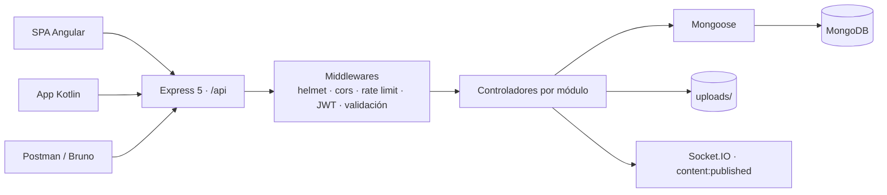
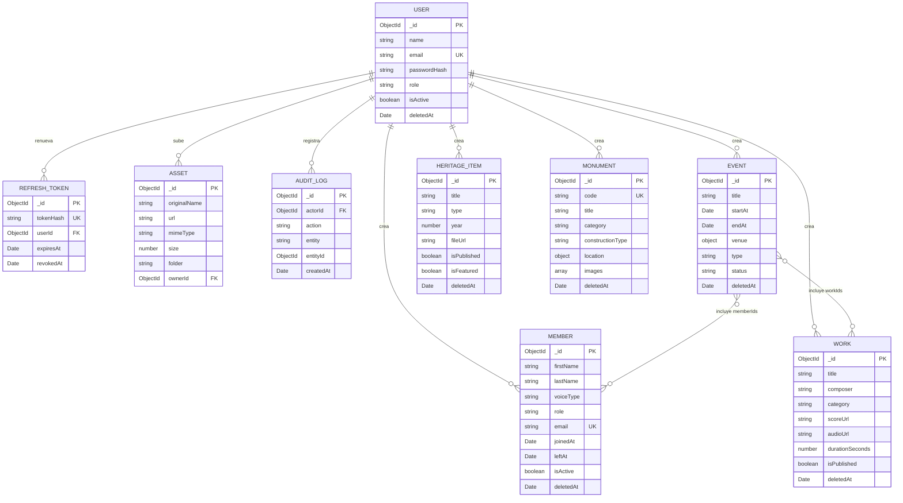
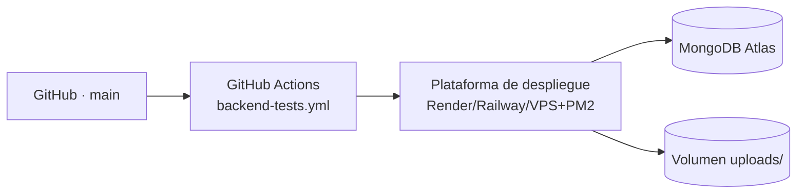

# Arquitectura y modelo de datos

Versión: 1.0 · Fecha: 2026-11-25 · Proyecto: Coro Patrimonial UNEFA

## 1. Visión arquitectónica

El sistema sigue una arquitectura modular en capas. El backend expone una API REST y eventos Socket.IO; el frontend Angular y la app Kotlin consumen el mismo contrato. Los archivos se almacenan en el sistema de archivos del servidor bajo `projects/backend/uploads/` y se sirven como estáticos.

### Capas

| Capa | Ubicación | Responsabilidad |
|---|---|---|
| Entrada | `index.js`, `bin/server.js` | Arranque, HTTP, Socket.IO, middlewares globales y rutas |
| Seguridad | `middlewares/` | Autenticación JWT, roles, CORS, límite de tasa, validación y errores |
| Dominio | `api/<modulo>/` | Rutas, controladores, modelos y lógica específica |
| Reutilización | `helpers/` | CRUD genérico, envelope de respuestas y tokens |
| Persistencia | `databases/mongodb.js`, modelos | Conexión y esquemas Mongoose |
| Archivos | `api/uploads/`, `uploads/` | Subida validada y entrega estática |
| Datos de prueba | `scripts/seeders/seed.js` | Usuarios y contenido inicial idempotente |

## 2. Modelo de datos

### Reglas de persistencia

- Borrado lógico con `deletedAt` en contenido; `User` usa `isActive=false`.
- Solo se expone públicamente contenido con `isPublished=true` o `status='published'` e integrantes con `isActive=true`.
- Los filtros públicos se aplican **después** de los filtros de query para impedir que un parámetro revele borradores o bajas.
- `RefreshToken` usa `revokedAt` y hash del token; nunca se guarda el token en claro.
- Los `workIds` y `memberIds` de `Event` se poblan al consultar el detalle.

## 3. Decisiones de arquitectura registradas

| ID | Decisión |
|---|---|
| AD-001 | Node.js 26 ESM, Express 5, Mongoose, Socket.IO, JWT + bcrypt, CORS y rate limit |
| AD-002 | Entidades, campos, rutas y eventos en inglés; documentación en español |
| AD-003 | Repositorio público con `main` protegida y flujo solo-PR |
| AD-004 | Borrado lógico y visibilidad restringida a contenido publicado |
| AD-005 | Exclusión de secretos, `node_modules`, logs y binarios del repo |
| AD-006 | Imágenes de monumentos en `/uploads/images` con nombre `<timestamp>-<random>.<ext>` y `$push` en `PUT` |
| AD-007 | Middleware `auth.middleware.js`, tokens con `type`, rotación atómica de refresh y detección de reutilización |

El detalle de cada decisión está en `memory/architecture_decisions.md`.

## 4. Contrato de API

- Base: `/api`. Envelope `{ ok, data }` o `{ ok: false, error: { code, message, details? } }`.
- Autenticación: `Authorization: Bearer <accessToken>` y cookie httpOnly `refreshToken`.
- Paginación: `?page=1&limit=20` → `{ items, total, page, limit, pages }`.
- Filtros: `?search=&tag=&type=&year=&featured=true` según entidad.
- Códigos: `VALIDATION_ERROR` 400, `UNAUTHORIZED` 401, `FORBIDDEN` 403, `NOT_FOUND` 404, `CONFLICT` 409, `RATE_LIMITED` 429, `SERVER_ERROR` 500.
- Listado completo de endpoints: `context/api_contracts.md`.

## 5. Despliegue previsto

Antes de cualquier actualización remota se ejecuta el protocolo de respaldo de `AGENTS.md`: copia de la fuente y `mongodump`, transferencia excluyendo `.env`, `node_modules` y `uploads/`, y recarga con `pm2 reload ecosystem.config.cjs --env production`.

## 6. Trazabilidad con el código

| Documento | Código relacionado |
|---|---|
| `context/system_context.md` | Visión general y público objetivo |
| `context/business_rules.md` | Reglas F1–F7 implementadas en controladores |
| `context/api_contracts.md` | Rutas de `api/*/routes.js` |
| `docs/requerimientos_casos_de_uso.md` | Casos de uso y pruebas en `tests/` |
| `memory/error_solutions.md` | Parches aplicados y su verificación |
